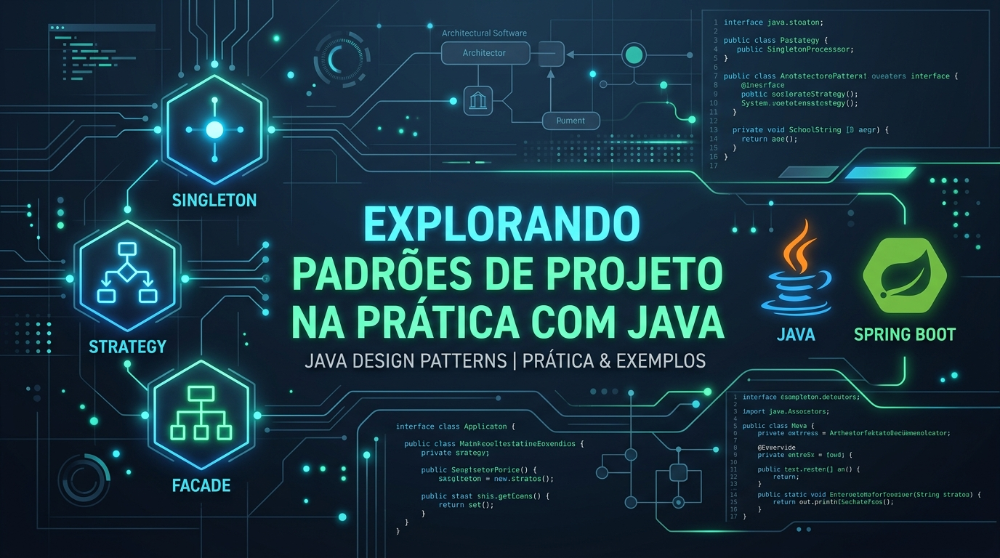

<div align="center">



# ☕ Explorando Padrões de Projeto na Prática com Java


[](https://github.com/Rafael-TOZATO/lab-padroes-projeto-java)
[](https://github.com/Rafael-TOZATO/lab-padroes-projeto-java)
[](https://github.com/Rafael-TOZATO)

</div>

---

## 📌 Sobre o Projeto

Este repositório contém as implementações práticas dos **Padrões de Projeto (Design Patterns)** da GoF (Gang of Four) desenvolvidos em **Java Puro**, sem dependência de frameworks externos.

O foco deste laboratório é compreender a estrutura fundamental, a orientação a objetos e a aplicação direta dos conceitos de arquitetura limpa em nível de código.

---

## 🏛️ Padrões de Projeto Implementados

| Padrão | Categoria | Descrição / Aplicação |
| :--- | :--- | :--- |
| 🧩 **Singleton** | Criacional | Garante a existência de apenas uma instância de uma classe, mantendo um ponto global de acesso. |
| 🎯 **Strategy** | Comportamental | Define uma família de algoritmos, encapsulando cada um deles e os torna intercambiáveis em tempo de execução. |
| 🏛️ **Facade** | Estrutural | Prove uma interface simplificada e unificada para um conjunto complexo de subsistemas (ex: CRM e CEP). |

---

## 🛠️ Tecno-Stack e Requisitos

- **Linguagem:** Java 17+ / OpenJDK
- **IDE Recomendada:** Eclipse / VS Code / IntelliJ IDEA
- **Paradigma:** Orientação a Objetos (POO) com Design Patterns GoF

---

## 📂 Estrutura de Pastas do Projeto

```text
src/
├── One/DigitalInnovation/gof/
│   ├── singleton/        # Implementações do Padrão Singleton
│   ├── strategy/         # Implementações do Padrão Strategy
│   └── facade/           # Implementação da Fachada Unificada
├── Subsistema1/CRM/       # Subsistema encapsulado de CRM
└── subsistema2/cep/       # Subsistema encapsulado de CEP

---

## 🐙 CÓDIGO E REPOSITÓRIOS
- **GitHub:** [github.com/Rafael-TOZATO](https://github.com/Rafael-TOZATO)

## ✍️ ARTIGOS E PUBLICAÇÕES
- **Medium:** [medium.com/@ornelas.tozato](https://medium.com/@ornelas.tozato)

## 📬 CONTATOS
- **E-mail:** ornelas.tozato@gmail.com
- **LinkedIn:** [rafaeltozato81](https://www.linkedin.com/in/rafaeltozato81)
- **GitHub:** [Rafael-TOZATO](https://github.com/Rafael-TOZATO)
- **Medium:** [@ornelas.tozato](https://medium.com/@ornelas.tozato)
- **Dev Hub:** [tozato-ai-core.vercel.app](https://tozato-ai-core.vercel.app)
- **H-Folio:** [h-folio-l0.vercel.app](https://h-folio-l0.vercel.app)
- **Microsoft Learn:** [rafaelornelastozato-2209](https://learn.microsoft.com/pt-br/users/rafaelornelastozato-2209)

-  **Microsoft Learn:** [Transcript](https://learn.microsoft.com/pt-br/users/rafaelornelastozato-2209/transcript/dzo2wizrzkx2853)
